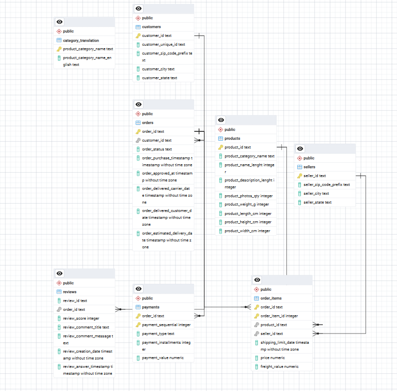

# Анализ данных маркетплейса Olist: от модели данных до витрины

## Цель
Пройти полный путь работы с данными на реальном датасете: спроектировать реляционную модель,
проверить качество данных и ответить на бизнес-вопрос: **как сроки доставки влияют на удовлетворённость клиентов**.

## Данные
[Brazilian E-Commerce Public Dataset by Olist](https://www.kaggle.com/datasets/olistbr/brazilian-ecommerce) (Kaggle):
около 100 тыс. заказов бразильского маркетплейса за 2016–2018 годы, 8 связанных таблиц:
заказы, позиции заказов, клиенты, товары, продавцы, платежи, отзывы, справочник категорий.

## Стек
PostgreSQL, pgAdmin 4 (Query Tool, ERD Tool)

## Структура репозитория
| Файл | Содержание |
|---|---|
| `00_setup.sql` | Создание таблиц, загрузка CSV, первичные и внешние ключи |
| `01_data_quality.sql` | Проверки качества данных |
| `02_analysis.sql` | Аналитические запросы |
| `03_mart.sql` | Витрина данных для дашборда |
| `erd.png` | ER-диаграмма модели данных |

## Модель данных

Центральная сущность — заказ (`orders`). К нему относятся позиции (`order_items`),
платежи (`payments`) и отзывы (`reviews`). Позиции ссылаются на товары (`products`)
и продавцов (`sellers`), заказ — на клиента (`customers`).

Ключи добавлялись после загрузки данных, и это сразу помогло найти проблемы в данных (см. ниже).

## Проверка качества данных (`01_data_quality.sql`)
- **Нарушение ссылочной целостности:** 2 категории товаров (`pc_gamer` и `portateis_cozinha_e_preparadores_de_alimentos`,
  13 товаров) отсутствуют в справочнике переводов, поэтому внешний ключ `products → category_translation` создать нельзя.
- **Пропуски:** 610 товаров без категории, 8 заказов в статусе «доставлен» без даты доставки,
  1 заказ без платежа.
- **Ловушка JOIN:** 2 961 заказ оплачен несколькими платежами. Прямое соединение позиций
  и платежей завышает выручку на 4,5%: 14 209 115 вместо 13 591 644. В анализе таблицы агрегируются до соединения.
- **Идентификатор клиента:** `customer_id` создаётся на каждый заказ (99 441 id),
  а реальных клиентов — 96 096 (`customer_unique_id`). Повторные покупки считаются по `customer_unique_id`.
- **Сверка сумм:** у 249 из 98 665 заказов (0,25%) стоимость товаров с доставкой расходится с суммой платежей
  больше чем на 1.
- **Отзывы:** у 547 заказов больше одного отзыва, поэтому оценка усредняется до уровня заказа.

## Аналитика (`02_analysis.sql`)
Учитываются только доставленные заказы.

- **Динамика:** выручка, количество заказов, средний чек по месяцам и рост к прошлому месяцу (`LAG`)
  за январь 2017 — август 2018 (данные 2016 года неполные). Выручка выросла с 112 тыс. в январе 2017
  до 0,8–1 млн в месяц в 2018 году. Пик — ноябрь 2017 (+52% к октябрю, вероятно, эффект Black Friday).
  Средний чек стабилен: 124–150.
- **Категории:** топ-10 по выручке (`RANK`). Лидер — health_beauty (9,3% выручки),
  за ней watches_gifts (8,8%) и bed_bath_table (7,7%). Топ-10 категорий дают около 62% выручки.
- **Повторные покупки:** только 3% клиентов (2 801 из 93 358) сделали больше одного заказа.
  Маркетплейс почти полностью держится на новых клиентах.

### Главный вывод: задержка доставки и оценка клиента
| Задержка относительно обещанной даты | Заказов | Средняя оценка | Доля оценок 1–2 |
|---|---|---|---|
| Вовремя или раньше | 89 443 | 4,29 | 9,2% |
| 1–3 дня | 1 852 | 3,29 | 32,2% |
| 4–7 дней | 1 748 | 2,11 | 67,6% |
| 8–14 дней | 1 446 | 1,67 | 80,1% |
| Более 14 дней | 1 335 | 1,73 | 78,2% |

**Практический вывод:** 93% заказов доставляются вовремя, но опоздание резко обрушивает оценку.
Уже при опоздании на 1–3 дня доля негативных отзывов вырастает в 3,5 раза (с 9% до 32%),
а при опоздании больше чем на 3 дня большинство оценок негативные (68–80%). Соблюдение обещанного
срока доставки — один из ключевых факторов оценки.
Бизнесу стоит контролировать опоздания (особенно у продавцов и регионов с наибольшими задержками)
или закладывать более реалистичный срок доставки при оформлении заказа.

## Витрина (`03_mart.sql`)
Представление `mart_order_items` объединяет заказы, позиции, клиентов, категории и отзывы.
Одна строка — одна позиция доставленного заказа. Отзывы предварительно агрегируются до уровня
заказа, чтобы не размножать строки. Корректность проверяется сверкой числа строк витрины с исходными данными.

## Дальнейшие шаги
- Дашборд в Yandex DataLens на основе витрины.
- Анализ задержек доставки в разрезе штатов и продавцов.
- Когортный анализ удержания клиентов.
